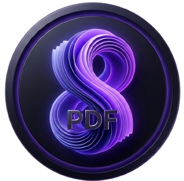
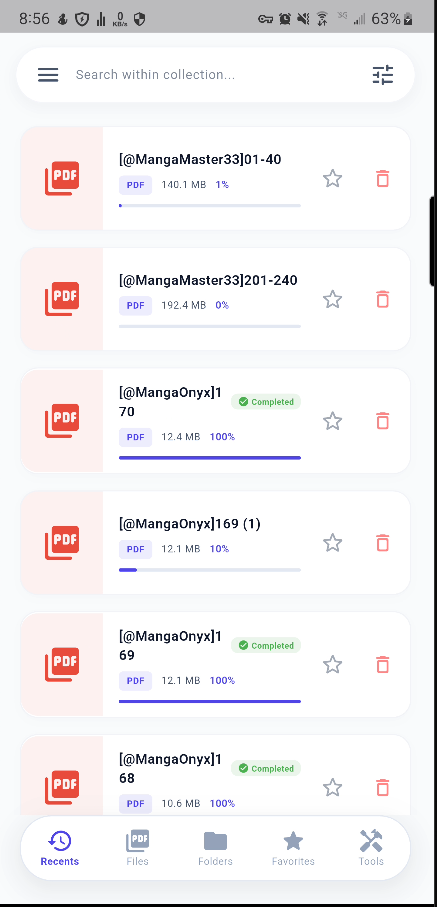
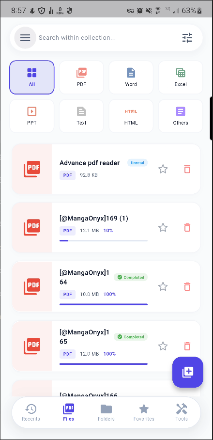
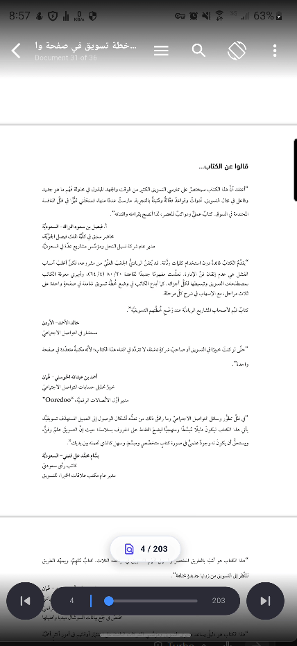
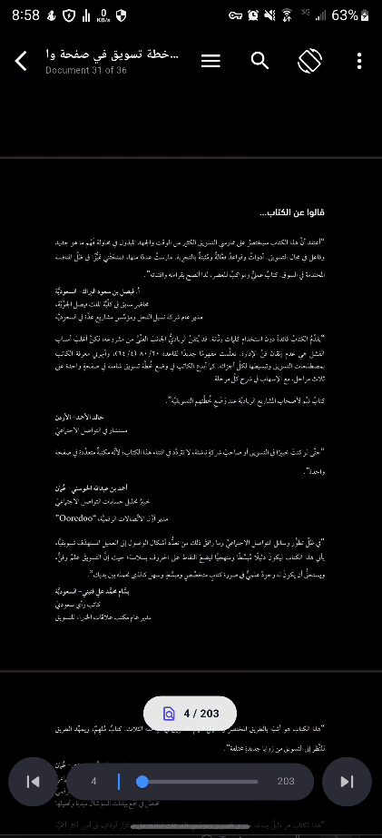
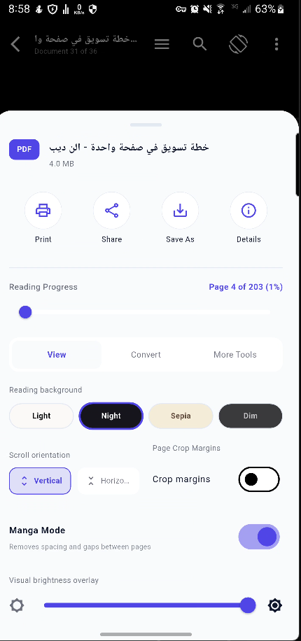
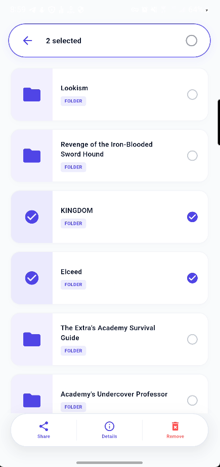
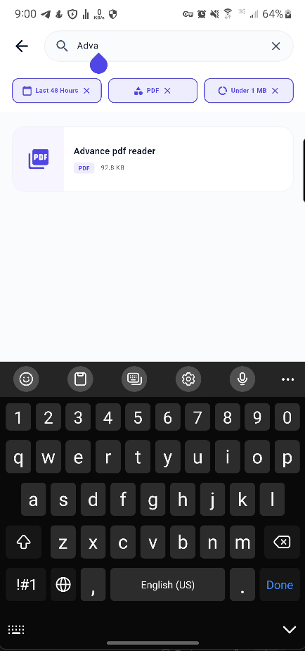
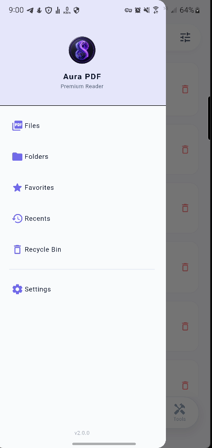

<div align="center">

  

  # 📄 Aura PDF Reader
  ### قارئ المستندات وكتب الـ PDF فائق السرعة والمتميز بصرياً
  
  **An ultra-fast, modern, offline-first PDF and document reader built with Flutter & GetX.**

  <br/>

  [](https://flutter.dev)
  [](https://dart.dev)
  [](https://pub.dev/packages/get)
  [](https://pub.dev/packages/pdfrx)
  [](LICENSE)

  <br/>

</div>

---

## 🌟 نظرة عامة (Overview)

**Aura PDF** هو قارئ مستندات متكامل وعصري، صُمم خصيصاً ليقدم تجربة قراءة فائقة السرعة، سلسة، ومريحة للعين بدون الحاجة للاتصال بالإنترنت. يجمع التطبيق بين التصميم الراقي الحديث (Modern Minimalist UI) وهندسة برمجية متقدمة تعتمد على محرك الرندرة عالي الكفاءة `pdfrx`، ليتعامل مع الكتب والمستندات الضخمة وتصفحها دون أي تأخير أو استهلاك مفرط للذاكرة.

---

## 📱 واجهات التطبيق (App Screenshots)

<div align="center">

| 1. الرئيسية (الملفات الأخيرة) | 2. متصفح المستندات والفلترة | 3. واجهة القارئ الرأسي | 4. الوضع الليلي (Dark Mode) |
|:---:|:---:|:---:|:---:|
|  |  |  |  |

| 5. أدوات القارئ واقتصاص الهوامش | 6. شريط التحديد المتعدد | 7. البحث الفوري داخل النص | 8. قائمة الانتظار (Queue Drawer) |
|:---:|:---:|:---:|:---:|
|  |  |  |  |

</div>

---

## 🚀 المميزات الرئيسية (Key Features)

### ⚡ 1. محرك قراءة متطور وفائق الأداء (High-Performance PDF Engine)
* **تصفح رأسي مستمر فائق السلاسة (Smooth Continuous Vertical Scroll)**: تصفح سلس وطبيعي لكافة صفحات المستند مع قفل تلقائي لحواف الشاشة لمنع الانحراف.
* **إدارة ذكية للذاكرة والرندرة (Memory Optimization)**: عزل الكاش وتكييف جودة الصورة ديناميكياً بناءً على كثافة بكسلات الشاشة (`devicePixelRatio`) دون تعليق أو وميض.
* **فتح الملفات الكبيرة والمانجا**: دعم ملفات الكتب والمجلات والمانجا حتى تلك التي تتجاوز 100 ميجابايت بكل سهولة.
* **حفظ نقطة التوقف لحظياً (Auto-Save Progress)**: حفظ الصفحة الحالية ونسبة التقدم لكل ملف، واستعادتها بدقة متناهية عند إعادة الفتح.

---

### 🎨 2. بيئة قراءة مخصصة ومريحة للعين (Eye-Friendly Reading Themes)
* **أربعة أوضاع لونية للقراءة**:
  * ☀️ **الوضع النهاري (Pure Day)**: خلفية بيضاء نقية مع خطوط واضحة وعالية التباين.
  * 🌙 **الوضع الداكن (Deep Obsidian)**: مظهر أسود فاخر مريح للعين في الإضاءة الخافتة ويوفر طاقة بطاريات AMOLED.
  * 📜 **وضع ورق البردي (Warm Sepia)**: درجات بنية دافئة تحاكي ملمس أوراق الكتب الكلاسيكية.
  * 🌫️ **الوضع الهادئ (Soft Gray)**: درجات رمادية متوازنة للتركيز وتقليل الإجهاد البصري.
* **تعتيم الشاشة الذكي (Brightness Dimmer)**: إمكانية خفض الإضاءة داخل القارئ لأدنى من الحد الأدنى المسموح به في النظام للقراءة الليلية الحساسة.
* **تدوير الشاشة السريع (Orientation Lock)**: قفل أو تدوير القراءة أفقياً ورأسياً بلمسة زر واحدة.

---

### 🛠️ 3. أدوات القراءة المتقدمة (Smart Reading Tools)
* **اقتصاص الحواف تلقائياً (Crop Margins)**: إزالة الهوامش البيضاء الفارغة حول الصفحات للاستفادة الكاملة من حجم الشاشة.
* **وضع المانجا الخاص (Manga Mode)**: إلغاء الفواصل بين الصفحات لعرض القصص المصورة والمانجا بشكل شريطي متصل.
* **العلامة المائية الحية (Live Watermark)**: إمكانية كتابة نص علامة مائية يظهر مائلاً بشفافية خفيفة فوق صفحات المستند لحماية الحقوق.
* **قائمة الانتظار السريعة (Reading Queue Drawer)**: دراور جانبي داخل القارئ يتيح التنقل المباشر والسريع بين المستندات دون الحاجة للخروج إلى الشاشة الرئيسية.
* **البحث الفوري داخل النص (In-Text Search)**: محرك بحث داخلي سريع يبرز الكلمات المطابقة مع عداد فوري وزري السابق والتالي للتنقل بين النتائج.

---

### 🗂️ 4. إدارة متكاملة للمكتبة والملفات (Library Management)
* **تصنيف وفلترة سريعة للمستندات**: فحص تلقائي وفوري لصيغ المستندات المتنوعة:
  * 📕 **PDF**
  * 📘 **Word (DOC/DOCX)**
  * 📗 **Excel (XLS/XLSX)**
  * 📙 **PowerPoint (PPT/PPTX)**
  * 📄 **النصوص (TXT)**
* **وضع التحديد المتعدد المتقدم (Multi-Selection Mode)**:
  * شريط تحكم عائم سفلي ذكي مطابق لقياسات شريط التنقل الأساسي.
  * إمكانية تحديد الكل بنقرة واحدة، الحذف المجمع الآمن، أو المشاركة المتعددة.
  * **نافذة التفاصيل الذكية (Details Sheet)**: عرض تفاصيل الحجم، المسار، الامتداد، وتاريخ التعديل للعناصر الفردية أو المتعددة.
* **سلة المحذوفات الذكية (Recycle Bin)**: حماية قصوى للملفات عبر نقلها لسلة محذوفات افتراضية بدلاً من الحذف الفوري، مع إمكانية الاستعادة بلمسة زر.

---

### 🔤 5. تخصيص الخطوط واللغات (Typography & Internationalization)
* **خطوط Google Fonts مدمجة**: دعم مجموعة راقية من أفضل الخطوط العربية والإنجليزية (`Cairo`, `Tajawal`, `Almarai`, `Amiri`, `Roboto`, وخط النظام الافتراضي).
* **معاينة حية للخط والحجم**: ديالوج تفاعلي يعرض شكل الخط المختار قبل تطبيقه مع 4 مستويات مختلفة لحجم الخط.
* **دعم ثنائي اللغة بالكامل (Bilingual RTL/LTR)**: محاذاة وتخطيط متكامل للغتين **العربية** و**الإنجليزية**.

---

## 🏗️ البنية التقنية والمعمارية (Architecture & Tech Stack)

يعتمد التطبيق على معمارية برمجية حديثة ونظيفة مستوحاة من مبادئ **Clean Architecture** بالاعتماد على **GetX Pattern**:

```text
lib/
├── core/                   # البنية التحتية المشتركة
│   ├── bindings/           # تهيئة وحدات التحكم العامة (AppBinding)
│   ├── constants/          # الثوابت، الألوان، والثيمات (AppThemes)
│   ├── localization/       # الترجمة للغتين (Arabic & English)
│   ├── services/           # التخزين المحلي والخدمات (StorageService)
│   ├── utils/              # دوال المساعدة، فحص الملفات والفرز الطبيعي
│   └── widgets/            # الويدجت المشتركة (CustomSplashScreen)
├── data/                   # طبقة البيانات
│   ├── models/             # نماذج تحويل واستقبال البيانات
│   └── repositories/       # مستودعات فحص الملفات
├── domain/                 # طبقة الأعمال والنطاق
│   ├── entities/           # الكيانات الأساسية (PdfEntity, LibraryItem)
│   └── repositories/       # العقود والواجهات البرمجية
├── modules/                # واجهات ووحدات التطبيق (Presentation)
│   ├── home/               # الواجهة الرئيسية، التبويبات وشريط التحديد
│   ├── folder/             # متصفح المجلدات والملفات الفرعية
│   ├── reader/             # محرك القارئ، التخطيط العمودي، والدايلوجات
│   ├── search/             # واجهة البحث المتقدم المتعدد
│   └── settings/           # إعدادات الثيم، الخطوط، وتفضيلات القراءة
└── routes/                 # المسارات والتنقل (AppPages & AppRoutes)
```

---

## 📦 الحزم والاعتمادات المستخدمة (Dependencies)

| الحزمة (Package) | الاستخدام (Usage) |
| :--- | :--- |
| **`pdfrx`** | محرك رندرة الـ PDF السريع مع دعم البحث والتخطيط المخصص |
| **`get`** | إدارة الحالة (State Management)، حقن التبعيات (DI)، والتنقل والترجمة |
| **`get_storage`** | التخزين المحلي عالي السرعة (Key-Value persistence) |
| **`google_fonts`** | تحميل وتطبيق الخطوط العربية والإنجليزية ديناميكياً |
| **`share_plus`** | مشاركة المستندات وملفات الـ PDF مع التطبيقات الأخرى |
| **`file_picker`** | استيراد واختيار المجلدات والملفات من الهاتف |
| **`app_links`** | فتح مستندات الـ PDF مباشرة من مدراء الملفات الخارجية في الهاتف |
| **`permission_handler`** | إدارة وتأكيد صلاحيات قراءة التخزين والملفات بأمان |

---

## 💻 طريقة التثبيت والتشغيل (Getting Started)

### المتطلبات المسبقة (Prerequisites)
* تثبيت **Flutter SDK** (إصدار `^3.8.1` أو أحدث).
* تثبيت **Android Studio** أو **VS Code** مع إضافات Flutter & Dart.

### خطوات التشغيل (Run Locally)

1. **استنساخ المستودع (Clone Repository):**
   ```bash
   git clone https://github.com/your-username/pdf_reader.git
   cd pdf_reader
   ```

2. **تحميل الاعتمادات (Fetch Dependencies):**
   ```bash
   flutter pub get
   ```

3. **فحص الكود والتحقق من السلامة (Code Analysis):**
   ```bash
   flutter analyze
   ```

4. **تشغيل التطبيق على الهاتف أو المحاكي (Run Application):**
   ```bash
   flutter run
   ```

5. **بناء نسخة الإنتاج للأندرويد (Build Release APK):**
   ```bash
   flutter build apk --release
   ```

---

## 🔒 الخصوصية والأمان (Privacy & Permissions)

* 🛡️ **يعمل بالكامل دون اتصال (100% Offline)**: لا يقوم التطبيق بإرسال أو رفع أي مستند إلى أي خوادم خارجية.
* 📂 **صلاحيات الوصول للتخزين**: تُستخدم أذونات قراءة الملفات فقط لفحص مستندات الجهاز وعرضها للمستخدم محلياً.
* ♻️ **حماية المستندات من الضياع**: ميزة سلة المحذوفات تمنع فقدان الملفات عن طريق الخطأ.

---

## 🤝 المساهمة (Contributing)

المساهمات مرحب بها دائماً! إذا كانت لديك فكرة لتطوير التطبيق أو ترغب في الإبلاغ عن مشكلة:
1. قم بعمل **Fork** للمشروع.
2. أنشئ فرعاً لميزتك (`git checkout -b feature/AmazingFeature`).
3. سجّل تغييراتك (`git commit -m 'Add some AmazingFeature'`).
4. ارفع الفرع (`git push origin feature/AmazingFeature`).
5. افتح **Pull Request**.

---

<div align="center">
  <sub>صُنع بكل ❤️ وبأعلى معايير الجودة والتصميم بواسطة <b>فريق تطوير Aura PDF</b></sub>
</div>
