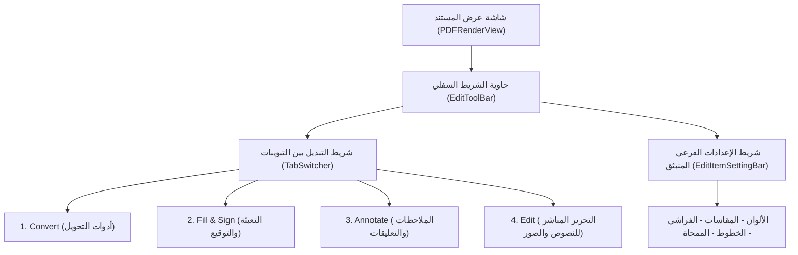
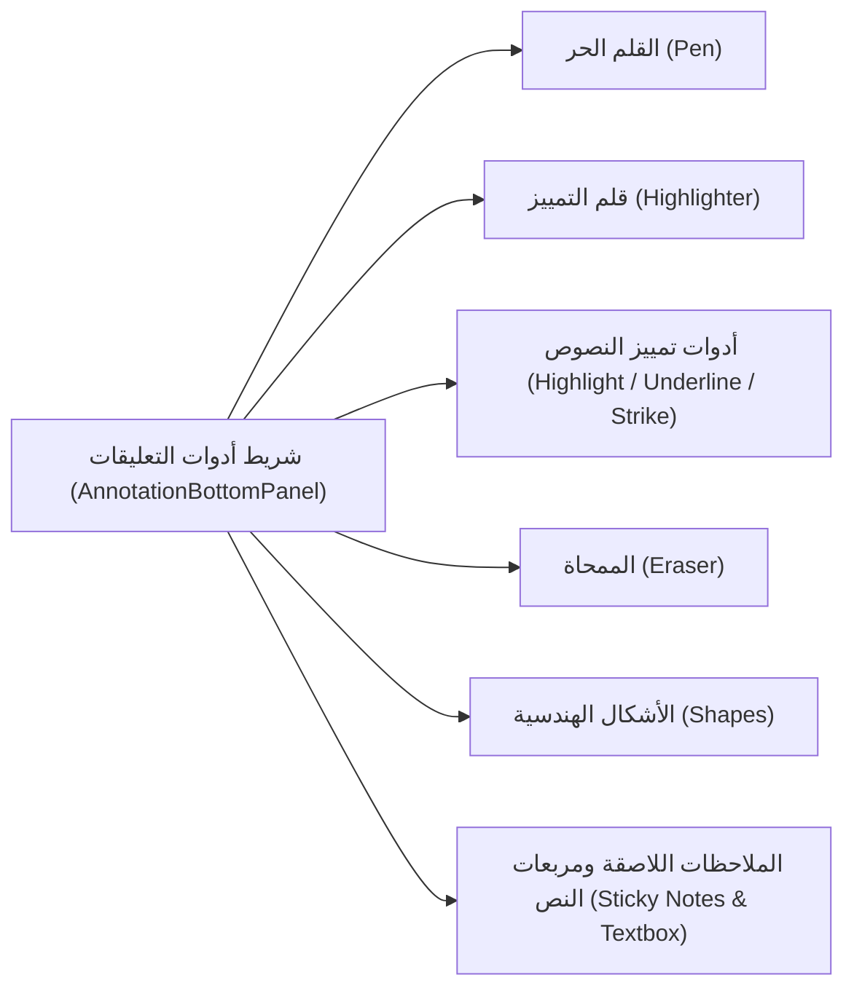

# الهندسة العكسية التفصيلية لمجموعات أدوات `WPS Office PDF`
## التشريح الكامل لأشرطة الأدوات: التحويل (`Convert`)، والتعبئة والتوقيع (`Fill & Sign`)، والملاحظات (`Annotate`)، والتحرير (`Edit`)

---

## الفهرس العام

1. [معمارية أشرطة الأدوات السفلية ونموذج التبويبات (Bottom Bar Architecture)](#1-معمارية-أشرطة-الأدوات-السفلية-ونموذج-التبويبات-bottom-bar-architecture)
2. [المجموعة الأولى: أدوات التحويل (Convert Group)](#2-المجموعة-الأولى-أدوات-التحويل-convert-group)
3. [المجموعة الثانية: أدوات التعبئة والتوقيع (Fill & Sign Group)](#3-المجموعة-الثانية-أدوات-التعبئة-والتوقيع-fill--sign-group)
4. [المجموعة الثالثة: أدوات التعليقات والملاحظات (Annotate Group)](#4-المجموعة-الثالثة-أدوات-التعليقات-والملاحظات-annotate-group)
5. [المجموعة الرابعة: أدوات التحرير والتعديل المباشر (Edit Group)](#5-المجموعة-الرابعة-أدوات-التحرير-والتعديل-المباشر-edit-group)
6. [الربط بين واجهة المستخدم (UI) والنواة الأصلية في C++ (JNI Bridge)](#6-الربط-بين-واجهة-المستخدم-ui-والنواة-الأصلية-في-c-jni-bridge)

---

## 1. معمارية أشرطة الأدوات السفلية ونموذج التبويبات (Bottom Bar Architecture)

أظهر التحليل العكسي لملفات البايت كود `classes14.dex` و `classes12.dex` أن `WPS Office` يدير أدوات التفاعل مع ملف الـ `PDF` من خلال بنية شريط تحكم ديناميكي يسمى:

```text
cn.wps.moffice.pdf.shell.toolbar.phone.edittoolbar.EditToolBar
```

ويتصل هذا الشريط بعقد واجهة موحد يُعرف برمز:
```text
cn.wps.moffice.pdf.shell.toolbar.phone.m2bottombar.a.EnumC0026a
```

ويحدد هذا العقد التبويبات الأساسية التي تظهر للمستخدم فور فتح المستند:
```kotlin
public enum EnumC0026a {
    TAB_EDIT,         // تبويب التحرير والتعديل
    TAB_ANNOTATION,   // تبويب التعليقات والملاحظات
    TAB_FILL_SIGN;    // تبويب التعبئة والتوقيع
}
```
بالإضافة إلى زر وأدوات التحويل (`Convert`) المدمجة في قائمة الأدوات الرئيسية `ToolItem` و `FileConvertBottomDialog`.

### هيكل طبقات العرض في الواجهة (`UI Hierarchy`):


---

## 2. المجموعة الأولى: أدوات التحويل (Convert Group)

### 2.1 المكونات والأنشطة البرمجية المسؤولة:
```text
cn.wps.moffice.main.fileconvert.view.FileConvertBottomDialog
cn.wps.moffice.main.local.home.dialog.ConvertBottomDialog
cn.wps.moffice.main.fileconvert.ui.FileConvertPDFDispatchActivity
cn.wps.moffice.pdf.shell.convert.ConvertService
```

### 2.2 الأدوات والخيارات المتاحة للمستخدم:
عند الضغط على خيار التحويل (`Convert`) من شريط الأدوات، تفتح نافذة سفلية منبثقة (`BottomSheetDialog`) تضم الخيارات التالية:

1. **التحويل من PDF إلى صيغ أخرى:**
   - **`PDF to Word` (`DOCX / DOC`):** يحول المستند مع استخراج النصوص وإعادة تشكيل الجداول والصور.
   - **`PDF to Excel` (`XLSX`):** مخصص للجداول والبيانات الرقمية، حيث يتعرف على شبكة الخلايا ويحولها لأعمدة وصفوف قابلة للحساب.
   - **`PDF to PowerPoint` (`PPTX`):** يحول كل صفحة في الـ `PDF` إلى شريحة عرض تقديمي مستقلة.
   - **`PDF to Picture` (`Long Image / Single Images`):** تحويل الصفحات إلى صور `PNG/JPG` عالية الدقة.
   - **`PDF to TXT`:** تجريد المستند من الرسوم واستخراج النص الصافي فقط.

2. **التحويل من صيغ أخرى إلى PDF:**
   - خيارات `Word to PDF`, `Excel to PDF`, `PPT to PDF`, و `Image to PDF`.

### 2.3 كيف تنفذ النواة عملية التحويل برمجياً؟
- **التحويل المحلي السريع (للصور والنصوص):**
  يتم محلياً بالكامل عبر النواة `libkwopdf.so` باستخدام دالة تصيير الصفحات `PageRaster_nStart` وتوليد ملفات الصور مباشرة على وحدة التخزين.
- **التحويل المتقدم (إلى `Word` و `Excel` و `PPT`):**
  نظراً لأن ملفات الـ `PDF` تفتقر إلى معلومات هيكلية منطقية عن تسلسل الفقرات وتداخل الجداول (`Semantic Structure`)، تقوم فئة `FileConvertPDFDispatchActivity` بفحص المستند:
  - إذا كان المستند ممسوحاً ضوئياً (`Scanned PDF`) يُطلب تفعيل محرك الـ `OCR`.
  - يُرفع الملف عبر قناة مشفرة إلى خوادم معالجة `WPS Cloud Conversion Server` التي تعتمد على خوارزميات ذكاء اصطناعي عميقة لإعادة بناء تخطيط الصفحة (`Layout Analysis & Table Reconstruction`)، ثم يُعاد تنزيل ملف الـ `Word` أو الـ `Excel` الناتج وفتحه تلقائياً للمستخدم.

---

## 3. المجموعة الثانية: أدوات التعبئة والتوقيع (Fill & Sign Group)

### 3.1 الفئات والمكونات البرمجية المسؤولة:
```text
cn.wps.moffice.pdf.shell.toolbar.phone.edittoolbar.item.FillFormItem
cn.wps.moffice.pdf.shell.annotation.panels.phone.PDFFillFormPanelItem
cn.wps.moffice.pdf.shell.annotation.panels.phone.AnnotationFillFormBottomPanel
cn.wps.moffice.pdf.core.formfill.PDFFormFill
```

### 3.2 أدوات التعبئة والتوقيع المكتشفة في الواجهة:
تتضمن لوحة `AnnotationFillFormBottomPanel` ست أدوات رئيسية (`ModeItemTypes 0-5`):

```java
public class PDFFillFormPanelItem {
    // كود الأداة الداخلي:
    // 0: Signature       (التوقيع الإلكتروني والبصري)
    // 1: Text Field      (إدخال نص حر في النماذج)
    // 2: Checkbox (✔)    (إشارة صح في مربعات الاختيار)
    // 3: Cross Mark (✖)  (إشارة خطأ / شطب)
    // 4: Dot / Radio (●) (نقطة اختيار دائرية)
    // 5: Date Stamp      (ختم التاريخ اللحظي)
}
```

#### تفصيل كل أداة وكيف تعمل:
1. **أداة التوقيع (`Signature`):**
   - **الإنشاء:** يتيح للمستخدم رسم التوقيع بالإصبع على لوحة تفاعلية، أو كتابة الاسم واختيار خط فني جاهز، أو رفع صورة التوقيع من المعرض مع ميزة إزالة الخلفية البيضاء تلقائياً.
   - **إعادة الاستخدام:** يُحفظ التوقيع محلياً في قاعدة مشفرة، ليتمكن المستخدم من النقر عليه وإدراجه فوراً في أي صفحة.
   - **التحكم بالتوقيع:** بعد وضعه، تظهر مقابض لتغيير حجمه، تدويره، ونقله إلى المكان المخصص فوق سطر التوقيع.
2. **أداة كتابة النصوص الحرة في النماذج (`Text Input`):**
   - مخصصة للنماذج الورقية الممسوحة ضوئياً التي لا تحتوي على حقول رقمية تفاعلية؛ ينقر المستخدم على أي سطر فارغ ليظهر مربع نصي يمكن كتابة الاسم، العنوان، أو الأرقام فيه مع إمكانية تكبير وتصغير حجم الخط ومطابقة تباعد الأحرف مع النموذج.
3. **أدوات الاختيار السريع (`Check, Cross & Radio Dot`):**
   - بنقرة واحدة، يضع المستخدم رمز الصح `✔` أو الخطأ `✖` أو النقطة `●` بالحجم المناسب داخل مربعات الاستبيانات والعقود الرسمية.
4. **ختم التاريخ التلقائي (`Date Stamp`):**
   - ينشئ ختماً جاهزاً بتاريخ اليوم بصيغة قابلة للتخصيص (مثل `2026-10-28` أو `28/10/2026`) ويوضع بنقرة واحدة بجانب التوقيع.

### 3.3 الآلية البرمجية في النواة:
- في النماذج الرقمية القياسية (`AcroForms`)، ترتبط هذه الأدوات بدوال النواة:
```c
PDFFormFill_native_actionForm(formHandle, fieldId, value);
PDFAnnotation_native_SetFormWidgetUpdateAppearance(annotHandle);
```
  حيث يُحدّث مجرى المظهر التفاعلي `/AP` في ملف الـ `PDF` لكي تظهر القيم والتوقيعات في أي برنامج قارئ آخر دون أي تشويه.

---

## 4. المجموعة الثالثة: أدوات التعليقات والملاحظات (Annotate Group)

### 4.1 الفئات والمكونات البرمجية المسؤولة:
```text
cn.wps.moffice.pdf.shell.toolbar.phone.edittoolbar.item.AnnoItem
cn.wps.moffice.pdf.shell.annotation.panels.phone.PDFAnnoPannelItem
cn.wps.moffice.pdf.shell.annotation.panels.phone.AnnotationBottomPanel
cn.wps.moffice.pdf.shell.annotation.panels.common.AnnoColorsGridView
cn.wps.moffice.pdf.shell.annotation.panels.common.PenThicknessView
cn.wps.moffice.pdf.shell.annotation.panels.common.AnnoShapeView
```

### 4.2 أدوات الملاحظات والتعليقات المكتشفة في الواجهة:



#### تفصيل الأدوات:
1. **قلم الرسم والكتابة الحرة (`Pen / Ink`):**
   - يتيح كتابة الملاحظات اليدوية والرسم الحر فوق الصفحات.
   - يرتبط بشريط الإعدادات المنبثق `AnnoColorsGridView` لاختيار الألوان، ومحدد السماكة `PenThicknessView` للتحكم بسماكة الخط بالمليمتر.
2. **قلم التظليل العريض (`Doodle Highlighter`):**
   - قلم رسم حر لكن بلون نصف شفاف (`50% Opacity`) لا يحجب النصوص والرسوم الموجودة خلفه.
3. **تمييز وتنسيق النصوص الرقمية (`Text Markup Tools`):**
   - **تظليل النص (`Text Highlight`):** تحديد كتل النصوص الأصلية وتلوين خلفيتها بالأصفر أو الأخضر أو الوردي؛ يُخزن في الـ `PDF` ككائن `/Highlight` محدد بإحداثيات الحروف `/QuadPoints`.
   - **التسطير (`Underline`):** رسم خط مستقيم دقيق تحت الكلمات المحددة.
   - **التشطيب / الشطب (`Strikethrough`):** رسم خط في منتصف الكلمات للإشارة إلى حذفها أو تصحيحها.
4. **الممحاة الذكية (`Eraser`):**
   - تتيح مسح ضربات القلم بنمطين:
     * **ممحاة الضربة بالكامل (`Stroke Eraser`):** بمجرد لمس أي جزء من الخط أو الرسم الحر، يُحذف المسار بالكامل.
     * **ممحاة المساحة (`Segment Eraser`):** تمسح الجزء الذي يمر عليه الإصبع فقط.
5. **الأشكال الهندسية (`AnnoShapeView`):**
   - رسم المستطيلات (`Rectangles`)، الدوائر والبيضاوي (`Circles/Ellipses`)، الخطوط المستقيمة (`Lines`)، والأسهم التوضيحية (`Arrows`) مع التحكم في لون الحد وسماكته ولون التعبئة الداخلية.
6. **الملاحظات اللاصقة ومربعات النصوص (`Sticky Note & Text Box`):**
   - **`Sticky Note`:** وضع أيقونة ملاحظة صفراء صغيرة فوق فقرة معينة، وعندما يضغط عليها القارئ تفتح نافذة تعرض نص الملاحظة وتاريخ إضافتها مع إمكانية الرد عليها.
   - **`Text Box`:** وضع مربع نصي مرئي ذي إطار ولون خلفية للكتابة المباشرة التوضيحية فوق الصفحة.

---

## 5. المجموعة الرابعة: أدوات التحرير والتعديل المباشر (Edit Group)

سألت تحديداً: **"لو في نص ولا شي أقدر أغيره، أقدر أكبره، أطلع خطه، كيف بيصير؟"**

هذه هي الميزة الأكثر تعقيداً هندسياً في تطبيقات الـ `PDF`، وإليك كيف ينفذها `WPS Office`:

### 5.1 الفئات والمكونات المسؤولة:
```text
cn.wps.moffice.pdf.shell.toolbar.phone.edittoolbar.item.KEditItem
cn.wps.moffice.pdf.shell.toolbar.phone.edittoolbar.widget.EditItemSettingBar
cn.wps.moffice.pdf.core.edit.PDFTextEditor
cn.wps.moffice.pdf.core.edit.PDFPageEditor
```

### 5.2 ماذا يحدث برمجياً فور دخول المستخدم وضع التعديل (`TAB_EDIT`)؟
1. **تحليل وتحديد كتل النصوص في الصفحة (`Text Block Parsing`):**
   تستدعي النواة الدالة:
```c
PDFPageEditor_native_setDocStatus(pageHandle, STATUS_EDITING);
```
   يقوم المحرك بفحص مجرى محتوى الصفحة (`Content Stream`) وتحديد كل جملة أو فقرة ووضع **مستطيل تحديد أزرق منقط** حولها (`Bounding Box`).
2. **تحديد النص ووضع المؤشر (`Caret Placement`):**
   عندما يضغط المستخدم بإصبعه على أي كلمة أو جملة:
   - تستدعي النواة الدالة:
```c
PDFTextEditor_native_enterEditFocus(editorHandle, touchX, touchY);
```
   - يظهر مؤشر الكتابة الوامض `Caret` في الموضع الدقيق بين الحروف.
   - تنبثق لوحة مفاتيح النظام تلقائياً للبدء في مسح أو كتابة نصوص جديدة.
3. **تعديل حجم الخط (`Change Font Size`):**
   يظهر في شريط `EditItemSettingBar` زران: `+` لتكبير الخط و `-` لتصغيره، أو قائمة لاختيار الحجم بالنقاط (مثل `10pt`, `12pt`, `16pt`).
   تستدعي النواة الدالة:
```c
PDFTextEditor_nChangeFontSize(editorHandle, newFontSize);
```
   يقوم المحرك بإعادة حساب المسافات بين الحروف وعرض السطور ومحاذاة الفقرة بالكامل حتى لا يخرج النص المكبر عن هوامش الصفحة.
4. **تغيير لون وتنسيق الخط (`Font Color & Style`):**
   - **تغيير اللون:** من خلال استدعاء الدالة الأصلية:
```c
PDFPageEditor_native_setTextColor(editorHandle, colorRGB);
```
   - **جعل الخط عريضاً (`Bold`) أو مائلاً (`Italic`):**
```c
PDFPageEditor_native_enableTextBold(editorHandle, isBold);
```
   - **محاذاة النص:** (يمين، يسار، وسط، وضبط كلي `Justify`):
```c
PDFPageEditor_native_setAlignment(editorHandle, alignType);
```
5. **معالجة الخطوط وتضمين الخطوط البديلة (`Font Replacement`):**
   إذا كان الخط الأصلي في ملف الـ `PDF` غير متوفر أو لا يدعم الحروف الجديدة (مثلاً المستند باللغة الإنجليزية والمستخدم يريد كتابة كلمات عربية)، تستدعي النواة محرك الخطوط `libfreetype-jni.so` والدالة:
```c
PDFTextEditor_native_addSupportReplaceFont(editorHandle, systemFontPath);
```
   حيث يتم تضمين خط النظام تلقائياً في المستند وكتابة الأحرف الجديدة بترميز سليم دون أن تظهر رموز غريبة أو مربعات فارغة.
6. **إضافة نص جديد بالكامل (`Add New Text Box`):**
   يتيح زر "إضافة نص" النقر في أي مساحة بيضاء على الصفحة لإنشاء كتلة نصية جديدة وضبط خطها ولونها وحجمها بحرية كاملة.
7. **تعديل صور المستند أثناء وضع التحرير:**
   يتيح وضع التحرير النقر على أي صورة أصلية موجودة في ملف الـ `PDF` لتحريكها، تصغيرها، تكبيرها، استبدالها بصورة جديدة من المعرض، أو حذفها نهائياً.

---

## 6. الربط بين واجهة المستخدم (UI) والنواة الأصلية في C++ (JNI Bridge)

يوضح الجدول التالي الربط المعماري الكامل بين عناصر التحكم التي يراها المستخدم في الواجهة ودوال النواة الصلبة المنفذة في مكتبة `libkwopdf.so`:

| المجموعة في الواجهة | أداة التحكم الملموسة | فئة الجافا المسؤولة | دالة النواة الأصلية المنفذة في `C++` |
| :--- | :--- | :--- | :--- |
| **Convert** | تحويل لصور / نص | `ConvertService` | `PageRaster_nStart` / `PageRaster_nContinue` |
| **Convert** | تحويل لـ `Word/Excel` | `FileConvertPDFDispatchActivity` | خوادم المعالجة السحابية `WPS Cloud API` |
| **Fill & Sign** | إدراج التوقيع | `PDFFillFormPanelItem` | `PDFDocument_native_getFillSign` |
| **Fill & Sign** | تعبئة حقول النماذج | `PDFFormFill` | `PDFFormFill_native_actionForm` |
| **Fill & Sign** | تحديث المظهر النهائي | `FillFormItem` | `PDFAnnotation_native_SetFormWidgetUpdateAppearance` |
| **Annotate** | القلم والرسم الحر | `AnnoItem` | `InkAnnotation_nAppendInkTrace` / `KPath_nCubicTo` |
| **Annotate** | التظليل والتسطير | `PDFAnnoPannelItem` | `PDFPage_native_addAnnot` (`/Highlight`, `/Underline`) |
| **Annotate** | الممحاة | `AnnoItem` | `PDFPage_native_deleteAnnot` |
| **Annotate** | الأشكال الهندسية | `AnnoShapeView` | `PDFPage_nAddPath` |
| **Edit** | تحديد وتعديل كتلة النص | `KEditItem` | `PDFTextEditor_native_enterEditFocus` |
| **Edit** | تكبير وتصغير حجم الخط | `EditItemSettingBar` | `PDFTextEditor_nChangeFontSize` |
| **Edit** | تغيير لون النص | `EditItemSettingBar` | `PDFPageEditor_native_setTextColor` |
| **Edit** | جعل الخط عريضاً | `EditItemSettingBar` | `PDFPageEditor_native_enableTextBold` |
| **Edit** | حفظ التعديلات في الملف | `EditToolBar` | `PDFPageEditor_native_saveText` |
