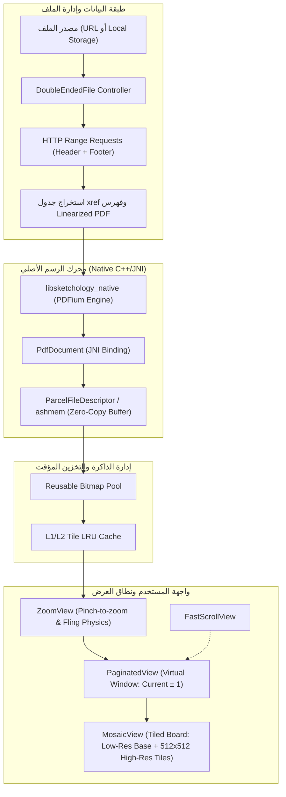

# التقرير الفني الشامل: معمارية وخوارزميات عرض ملفات `PDF` الضخمة المستخلصة من `Google Drive`

هذا التقرير مُعد ومُوجّه لمطوري مشروع `Advanced PDF Reader` ليكون دليلاً هندسيًا كاملاً يتضمن الخوارزميات، والآليات المعمارية، ونماذج التنفيذ البرمجي المستخلصة من تفكيك تطبيق `Google Drive` على `Android`.

---

## 1. الملخص التنفيذي والأهداف الهندسية

تعتمد تجربة فتح ملفات `PDF` العملاقة (التي تتجاوز `100MB` أو مئات الصفحات) بسلاسة في `Google Drive` على حل أربع معضلات رئيسية:
1. **سرعة الفتح الأولي دون انتظار اكتمال التنزيل:** الفتح الفوري في أجزاء من الثانية عبر الشبكة.
2. **استقرار الذاكرة ومنع أخطاء الانهيار (`Out Of Memory - OOM`):** استهلاك ذاكرة ثابت ومحدد بغض النظر عن حجم الملف أو دقة التكبير (`Zoom`).
3. **سلاسة التمرير بسرعة 60/120 إطاراً في الثانية (`60/120 FPS`):** عدم تجميد واجهة المستخدم (`UI Thread`) أثناء الانتقال السريع بين الصفحات.
4. **وضوح التفاصيل عند أقصى تكبير:** استرجاع تفاصيل الخطوط والرسومات الدقيقة دون تهنيج.

---

## 2. المخطط المعماري للنظام (`System Architecture`)

يوضح الرسم التالي دورة حياة البيانات من الشبكة/الملف المحلي حتى الرسم على الشاشة:



---

## 3. الخوارزميات الجوهرية الأربعة

### الخوارزمية الأولى: التحميل التدريجي ثنائي الأطراف (`Double-Ended Progressive Loading`)

#### المشكلة:
في ملفات `PDF` القياسية، يتم تخزين جدول الفهارس والإشارات المرجعية (`xref table`) وقاموس التذييل (`trailer dictionary`) في **نهاية الملف**، بينما البيانات الوصفية (`Header`) في **بداية الملف**. القارئ التقليدي ينتظر تحميل الملف كاملاً عبر الشبكة ليتمكن من قراءة الفهرس، مما يسبب بطء الفتح لملفات `100MB+`.

#### الحل المكتشف في كود `Google Drive` (`DoubleEndedFile`):
1. إرسال طلبي `HTTP Range Requests` متوازيين عبر رأس `Range: bytes=...`:
   - الطلب الأول: قراءة بايتات الرأس `Header` (مثلاً أول `32KB`).
   - الطلب الثاني: قراءة بايتات النهاية `Footer` (مثلاً آخر `32KB`).
2. فحص هل المستند مهيأ كـ `Linearized PDF` (المعروف بـ `Fast Web View`):
   - إذا كان كذلك، فإن كائنات الصفحة الأولى ومخططها موجودة فوراً في بداية الملف بعد الرأس مباشرة.
3. يقوم الصنف `DoubleEndedFile` بالتحكم في مؤشرين متقابلين:
   - `headerSize`: يزداد مع القراءة من البداية للأمام.
   - `footerSize`: يزداد مع القراءة من النهاية للخلف.
4. طلب الصفحات عند الطلب: عند انتقال المستخدم لصفحة معينة في المنتصف، يتم استدعاء دالة `requestRange(offset, length)` لتحميل النطاق المطلوب فقط دون تحميل ما قبله أو ما بعده.

```kotlin
// خوارزمية شبه برمجية للتحميل التدريجي
class ProgressivePdfDownloader(val url: String, val totalSize: Long) {
    suspend fun openDocument(): InitialPdfData {
        // 1. طلب متزامن لأول وآخر 32 كيلوبايت
        val headerChunk = fetchByteRange(url, start = 0, length = 32768)
        val footerChunk = fetchByteRange(url, start = totalSize - 32768, length = 32768)
        
        // 2. تمرير البيانات لمحرك الـ PDF لاستخراج فهرس الصفحات
        val docHandle = nativeInitProgressive(headerChunk, footerChunk, totalSize)
        
        // 3. التحقق من إمكانية عرض الصفحة الأولى فوراً
        val firstPageReady = nativeIsPageAvailable(docHandle, pageIndex = 0)
        return InitialPdfData(docHandle, firstPageReady)
    }

    suspend fun loadPageRange(offset: Long, length: Int) {
        val pageBytes = fetchByteRange(url, offset, length.toLong())
        nativeProvideBytes(pageBytes, offset)
    }
}
```

---

### الخوارزمية الثانية: تقسيم الصفحة إلى بلاطات ديناميكية (`Tiled Mosaic Rendering`)

#### المشكلة:
صفحة `A4` بدقة تكبير `300 DPI` أو تكبير `4x` على شاشة هاتف بدقة `QHD` تحتاج صورة نقطية بأبعاد تفوق `4000x3000` بكسل. هذه الصورة الواحدة بصيغة `ARGB_8888` تستهلك:
`4000 \times 3000 \times 4 \text{ bytes} \approx 48 \text{ MB}`.
وجود صفحتين أو ثلاث في الذاكرة بهذا الحجم يقود فوراً إلى `OutOfMemoryError`.

#### الحل المكتشف في كود `Google Drive` (`MosaicView` و `TileBoard`):
1. **الرسم ثنائي المراحل (`Two-Phase Rendering`):**
   - **المرحلة الأولى:** عند فتح الصفحة أو التمرير السريع، يتم رسم صورة مصغرة كاملة ومنخفضة الدقة (`Low-Res Base Bitmap`) بأبعاد صغيرة لا تتجاوز حجم الشاشة (مثلاً أقصى بُعد `1024px`) وتُمدد عبر `Canvas.scale`.
   - **المرحلة الثانية:** عند توقف التمرير أو التكبير، يتم تقسيم مساحة العرض إلى شبكة بلاطات قياسية (`Tiles`) بحجم `512x512` بكسل.
2. **رسم البلاطات المرئية فقط (`Viewport Intersection`):**
   - يتم حساب تقاطع المستطيل المرئي للشاشة (`Visible Viewport Rect`) مع البلاطات.
   - يتم طلب رسم البلاطات المتقاطعة فقط عبر الدالة الأصلية:
```java
renderTileFd(pageIndex, tileX, tileY, tileWidth, tileHeight, targetWidth, targetHeight, ...)
```
3. **تفريغ البلاطات الخارجة:** بمجرد خروج أي بلاطة من نطاق الرؤية بمقدار هامش معين، يتم تفريغ كائن الـ `Bitmap` الخاص بها فوراً وإرجاعه إلى حوض التدوير (`Bitmap Pool`).

```kotlin
// خوارزمية حساب البلاطات الظاهرة
fun calculateVisibleTiles(
    viewport: Rect, 
    zoomScale: Float, 
    tileSize: Int = 512
): List<TileRequest> {
    val scaledPageWidth = (originalWidth * zoomScale).toInt()
    val scaledPageHeight = (originalHeight * zoomScale).toInt()

    val startCol = (viewport.left / tileSize).coerceAtLeast(0)
    val endCol = (viewport.right / tileSize).coerceAtMost(scaledPageWidth / tileSize)
    val startRow = (viewport.top / tileSize).coerceAtLeast(0)
    val endRow = (viewport.bottom / tileSize).coerceAtMost(scaledPageHeight / tileSize)

    val requests = mutableListOf<TileRequest>()
    for (row in startRow..endRow) {
        for (col in startCol..endCol) {
            requests.add(TileRequest(row = row, col = col, scale = zoomScale))
        }
    }
    return requests
}
```

---

### الخوارزمية الثالثة: محاكاة التمرير الافتراضي وإلغاء المهام المعلقة (`Virtual Windowing & Fling Debounce`)

#### المشكلة:
عند قيام المستخدم بسحب التمرير السريع (`Fling`) عبر `100` صفحة، إذا حاولت كل صفحة طلب مهام رسم وفك ضغط في الخلفية، ستختنق وحدة المعالجة المركزية (`CPU Throttling`) وستتجمد الشاشة.

#### الحل المكتشف في كود `Google Drive` (`PaginatedView` و `FastScrollView`):
1. **نافذة الرؤية الافتراضية (`Sliding Window`):**
   - يتم الحفاظ على كائنات العرض للصفحات الظاهرة فعلياً فقط، مع صفحة واحدة قبلها وصفحة بعدها كمنطقة احتياطية (`Current Page ± 1`).
   - في كود `PaginatedView`، يُستخدم `SparseArray` وتُرمى استثناءات إذا تم استخدام `addView` التقليدي، حيث يُدار الإنشاء والحذف داخلياً فقط.
2. **إلغاء مهام الرسم أثناء القصور الذاتي (`Fling Debouncing`):**
   - عند اكتشاف حركة تمرير سريعة (`OnFling`)، يتم تجميد طلبات رسم البلاطات عالية الدقة (`Hi-Res Tiles`).
   - يُكتفى فقط برسم الصور المصغرة المخزنة مسبقاً (`Low-Res Thumbnails`) أو مستطيلات العناصر النائبة (`Placeholders`).
   - يتم تفعيل موقت استقرار (`Settling Timeout` بحوالي `150ms-200ms`): بمجرد استقرار التمرير أو تباطؤ السرعة دون حد معين، يتم إطلاق طلبات البلاطات التفصيلية للصفحة الحالية فقط.

---

### الخوارزمية الرابعة: إدارة الذاكرة وتفادي ضغط مجمّع النفايات (`Zero-Copy Shared Memory`)

#### المشكلة:
تمرير مصفوفات البايتات (`byte[]`) أو كائنات `Bitmap` الكبيرة بين بيئة الكود الأصلي (`C++`) وبيئة `Java/Kotlin` يُلزم النظام بعمليات نسخ ذاكرة متكررة، ويثير مجمّع النفايات (`GC Pauses`) مسبباً سقوط الإطارات (`Dropped Frames`).

#### الحل المكتشف في كود `Google Drive` (`sketchology_native` و `bitmap_parcel`):
1. الاعتماد على `ParcelFileDescriptor` وذاكرة أندرويد المشتركة (`ashmem / SharedMemory`).
2. يقوم المحرك الأصلي بالرسم مباشرة في مخزن الذاكرة الموجه بواسطة واصف الملف (`detachFd()`).
3. الاستدعاء الصريح لتحرير الموارد: بمجرد مغادرة الصفحة للنافذة النشطة، يُستدعى التابع:
```java
pdfDocument.releasePage(pageIndex);
```
   مما يحرر كائنات تمثيل الصفحة في المحرك الأصلي (`FPDF_ClosePage` في `PDFium`) لتجنب استهلاك الذاكرة العشوائية خارج بيئة `Java Heap`.

---

## 4. مقارنة استراتيجيات البناء لمشروع `Advanced PDF Reader`

أمام فريق التطوير خياران رئيسيان تم تحليلهما من خلال الكود:

| وجه المقارنة | الخيار 1: استخدام `AndroidX Jetpack PDF` (`androidx.pdf:pdf-viewer`) | الخيار 2: بناء محرك مخصص مستوحى من `Google Drive` (`Custom Tiled Engine`) |
| :--- | :--- | :--- |
| **المكونات الأساسية** | `androidx.pdf.view.PdfView`, `PdfDocumentServiceImpl` | محرك `PDFium Android` + مكونات `Tiled Canvas / Compose` مخصصة |
| **سرعة التنفيذ** | سريعة جداً (مكتبة رسمية جاهزة من جوجل). | تتطلب وقتاً متوسطاً لبناء نظام البلاطات وتدوير الذاكرة. |
| **التحكم المعماري** | تحكم محدود بواجهات المكتبة الرسمية وسلوكها الافتراضي. | تحكم كامل ودقيق في التخزين المؤقت، والبلاطات، والتمرير، والتحميل التدريجي. |
| **دعم الأنظمة القديمة** | يتطلب إصدارات نظام أحدث للاستفادة الكاملة من كامل المزايا. | متوافق مع كافة الإصدارات بدءاً من `Android 7.0` فما فوق. |
| **الاستخدام المثالي** | إذا كان الهدف قارئ مدمج سريع دون الحاجة لتخصيص عميق. | **(موصى به لمشروعك)** لتحقيق أعلى أداء في الملفات الضخمة والتحميل المزدوج. |

---

## 5. خطة التنفيذ البرمجية الموصى بها لمشروعك (`Implementation Blueprint`)

### المكون 1: واجهة التمرير والتحكم في البلاطات (`TiledView`)
- قم بإنشاء عرض مخصص (`Custom View` أو `Compose Layout`) يتكون من طبقتين:
  - **طبقة الأساس (`Base Layer`):** كائن `Bitmap` منخفض الجودة لكامل الصفحة يُعرض بشكل ثابت عند أي عملية تحجيم.
  - **طبقة التفاصيل (`Detail Layer`):** ترسم البلاطات المستلمة من مصفوفة المعالجة الخلفية فقط داخل المستطيل المرئي.

### المكون 2: حوض تدوير الـ `Bitmap` (`Bitmap Pool`)
- استخدم `BitmapFactory.Options.inBitmap` أو خزان كائنات بحجم ثابت `512x512` بصيغة `RGB_565` (إذا لم تكن الصفحة تحتوي شفافية لتقليل الذاكرة للنصف إلى `512KB` لكل بلاطة بدلاً من `1MB`).
- أعد استخدام كائنات `Bitmap` عند تفريغ البلاطات الخارجة لتفادي حجز مصفوفات جديدة في الذاكرة.

### المكون 3: منظومة المعالجة الخلفية المتزامنة (`Coroutines Dispatcher`)
- خصص `CoroutineDispatcher` بعدد مسارات عمل محدد (`Limited Parallelism`، مثلاً مسارين أو 3 مسارات) لعمليات `Render` الأصلية:
```kotlin
val pdfRenderDispatcher = Dispatchers.Default.limitedParallelism(3)
```
- امنح مهام الصفحة الحالية الأولوية القصوى (`Priority.HIGH`)، ومهام التخزين المسبق للصفحات التالية أولوية منخفضة (`Priority.LOW`)، مع إلغاء المهام فور مغادرة نطاق الرؤية.

---

> [!TIP]
> **التوصية الذهبية لسرعة الفتح:**
> إذا كانت ملفات `PDF` تأتي عبر خادم ويب يخص التطبيق، تأكد من عمل تحسين `Linearization` للملفات على الخادم (عبر أداة مثل `qpdf --linearize input.pdf output.pdf`) مع تفعيل دعم `Accept-Ranges: bytes` في خادم الويب، ليتمكن خوارزم `DoubleEndedFile` من فتح ملف بحجم `500MB` خلال أقل من 300 جزء من الثانية.
